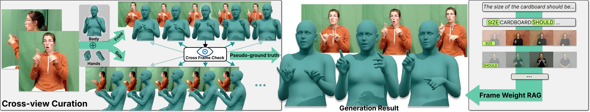
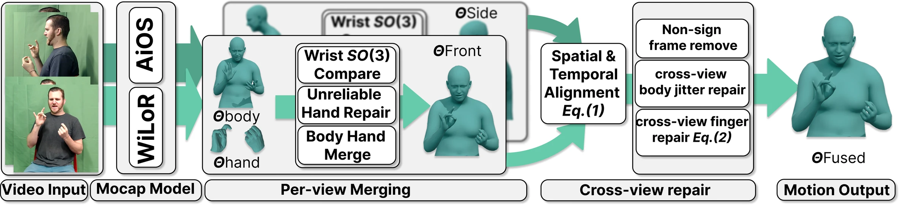
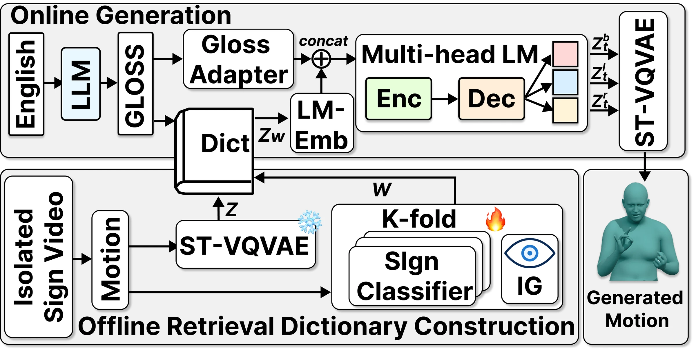
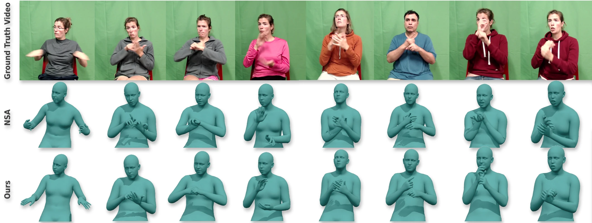

<div align="center">

# MV-Sign

### Multi-View 3D Motion Integration and Enhanced Text-to-Motion Conditioning for Sign Language Production

**WACV 2027**

[](#overview)
[](https://huggingface.co/datasets/mage0001/How2Sign-MV3D)
[](https://huggingface.co/datasets/mage0001/ASLCitizen-3D)
[](https://huggingface.co/datasets/mage0001/SGNify-MV)

**[Overview](#overview) · [Datasets](#datasets) · [Quick Start](#quick-start) · [Curation Pipeline](#curation-pipeline) · [Generation](#text-to-sign-generation) · [Release Status](#release-status)**



</div>

## Overview

MV-Sign connects **better 3D signing-motion supervision** with **better text-to-motion conditioning**. The data pipeline combines whole-body estimates from AiOS with hand estimates from WiLoR, jointly checks frontal and side views over time, and produces a single curated SMPL-X motion sequence. The production model combines a sign-aware ST-VQVAE, pseudo-gloss conditioning, and keyframe-aware retrieval to generate signing motion from text.

### Highlights

- **Cross-view motion curation:** per-view body/hand fusion, spatial-temporal alignment, wrist/finger reliability checks and repair, non-sign pruning, motion blending, and smoothing.
- **118,264 released motion sequences:** 34,939 continuous How2Sign-MV3D sequences and 83,325 isolated ASLCitizen-3D sequences.
- **Reusable annotations and diagnostics:** original saved How2Sign pseudo-gloss labels, plus 114 frontal/side SGNify-MV rendered videos with explicit frame correspondence.
- **Sign-aware production:** joint body/hand tokenization with three token streams, a pseudo-gloss adapter, and retrieval prompts selected using per-clip sign-recognizer attribution.

> **Available now:** final motion datasets, pseudo-gloss annotations, SGNify-MV videos, and extraction/curation code. Generator training code, pretrained generation weights, and SGNify rendering code are not yet included; see [release status](#release-status).

## News

- **2026-11-07:** Added illustrated method documentation and a dataset download/loading guide.
- **2026-11:** Released How2Sign-MV3D, ASLCitizen-3D, How2Sign pseudo-gloss annotations, SGNify-MV, and the motion extraction/curation pipeline.

## Datasets

Large archives are hosted on Hugging Face, not in this Git repository. Each released motion sample contains **one final SMPL-X NPZ sequence**, not separate frontal and side training targets.

| Resource | Contents | Size / count | Access |
|---|---|---|---|
| **How2Sign-MV3D** | Continuous ASL motion, curated with frontal/side evidence | **34,939 sequences** | [Download](https://huggingface.co/datasets/mage0001/How2Sign-MV3D) |
| **ASLCitizen-3D** | Isolated ASL motion, reconstructed from single-view videos | **83,325 sequences** | [Download](https://huggingface.co/datasets/mage0001/ASLCitizen-3D) |
| **How2Sign pseudo-gloss** | Original saved GPT-5.2 labels and sentence identifiers | **35,263 source sentences** | [Download](https://huggingface.co/datasets/mage0001/How2Sign-PseudoGloss) |
| **SGNify-MV** | Rendered frontal/side videos with camera/render metadata | **57 signs / 114 videos, 30 FPS** | [Download](https://huggingface.co/datasets/mage0001/SGNify-MV) |
| **MM-WLAuslan-MV3D** | Final SMPL-X motion sequences | Release in preparation | Pending |

**How2Sign-MV3D split:** 30,903 train / 1,711 validation / 2,325 test. These counts describe the regenerated release, not a rerun of the paper's training experiments. Pseudo-gloss labels retain the original sentence set; join identifiers with the motion manifest instead of assuming equal counts or positional correspondence.

The motion releases are **reconstructed estimates, not motion-capture ground truth**. Raw source videos, original SGNify GT meshes, SMPL-X/MANO model assets, and pretrained estimator weights are not bundled. SGNify-MV contains rendered videos and metadata, **not a complete Blender scene**.

See the [download and loading guide](docs/getting_started.md), [resource details and terms](docs/data_release.md), and the individual dataset cards for exact schemas, frame rates, manifests, and checksums.

## Quick Start

### Use the released motions

No AiOS/WiLoR inference or GPU is needed to load final motion parameters.

```bash
git clone https://github.com/ronggong000/MV-Sign.git
cd MV-Sign
pip install numpy huggingface_hub
```

Download How2Sign-MV3D (this downloads the full motion release):

```python
from huggingface_hub import snapshot_download

snapshot_download(
    repo_id="mage0001/How2Sign-MV3D",
    repo_type="dataset",
    local_dir="datasets/How2Sign-MV3D",
)
```

Verify and extract the tar shards:

```bash
cd datasets/How2Sign-MV3D
sha256sum -c SHA256SUMS
mkdir -p extracted
for archive in data/*.tar; do tar -xf "$archive" -C extracted; done
```

Read one motion:

```python
from pathlib import Path
import numpy as np

path = next(Path("extracted/train").glob("*.npz"))
with np.load(path, allow_pickle=False) as motion:
    poses = motion["poses"]                 # (T, 55, 3), local axis-angle, radians
    betas = motion["betas"]                 # fitted body-shape parameters
    fps = float(motion["mocap_framerate"])   # read metadata; do not assume 30 FPS
    print(path.name, poses.shape, betas.shape, fps)
```

SMPL-X/MANO assets are needed separately to reconstruct meshes, but not to inspect NPZ arrays. The [loading guide](docs/getting_started.md) explains temporal masks, pseudo-gloss joins, archive access, and camera/translation caveats.

## Curation Pipeline

<p align="center">
  
</p>

1. **Extract:** run AiOS for whole-body SMPL-X estimates and WiLoR for detailed left/right hand estimates.
2. **Fuse within each view:** check wrist/hand reliability and combine compatible body and hand estimates.
3. **Align and jointly repair:** compare both views and neighboring frames to identify unreliable wrist/finger articulation. This is a cross-view consistency process, not simply copying one view's hands into the other.
4. **Curate time and smooth:** remove detected non-sign spans, insert motion-blend transitions, and apply body smoothing.
5. **Save one final motion:** use the frontal body coordinate representation for the released sequence; side outputs are diagnostic intermediates, not additional training samples.

For saved estimator predictions, CPU curation can be run with:

```bash
pip install -r pipeline/requirements_cpu.txt
python pipeline/curate.py \
  --aios-front raw/aios/clip_front_amass.npz \
  --wilor-front raw/wilor/clip_front_hands.npz \
  --aios-side raw/aios/clip_side_amass.npz \
  --wilor-side raw/wilor/clip_side_hands.npz \
  --fps 24 --sample-id clip --split train --out final/clip.npz
```

Here `24` is an example: supply the two input videos' **actual common decoded FPS**. The wrapper does not resample mismatched frame rates. Non-sign removal and coif3 level-2 body smoothing are enabled. Non-sign pruning operates on motion; it does not reannotate text or establish word-level alignment.

**[Full pipeline instructions](pipeline/README.md)** cover GPU extraction, model dependencies, exact source snapshots, thresholds, coordinate-frame constants, temporal bookkeeping, and the separate **single-view utility** used when paired views are unavailable.

## Text-to-Sign Generation

<p align="center">
  
</p>

- **Sign-aware ST-VQVAE:** jointly encodes the 43-joint upper-body/hand skeleton before quantizing into body, left-hand, and right-hand token streams.
- **Pseudo-gloss adapter:** converts offline pseudo-gloss sequences into conditioning representations for the SOKE-style autoregressive generator.
- **Keyframe-aware retrieval:** selects informative isolated-sign motion tokens using out-of-fold sign-recognizer Integrated Gradients. Selection is performed per clip; it does not impose a Gaussian trimming window on every sign.

The architecture retains the three-stream generation interface of SOKE. The current public code release covers **motion extraction and curation**; it does not yet provide an end-to-end text-to-motion training or inference command.

## Qualitative Results

<p align="center">
  
</p>

Examples from the paper compare source RGB (top), NSA reconstructions (middle), and our curated motions (bottom), illustrating differences in wrist and finger articulation. The RGB row is a visual reference, not 3D motion-capture ground truth. These paper illustrations are not a claim of an additional paired 3D ground-truth release.

## Release Status

| Component | Status | Location |
|---|---|---|
| How2Sign-MV3D final motions | Available | [Hugging Face](https://huggingface.co/datasets/mage0001/How2Sign-MV3D) |
| ASLCitizen-3D final motions | Available | [Hugging Face](https://huggingface.co/datasets/mage0001/ASLCitizen-3D) |
| Original How2Sign pseudo-gloss labels | Available | [Hugging Face](https://huggingface.co/datasets/mage0001/How2Sign-PseudoGloss) |
| SGNify-MV videos and render metadata | Available | [Hugging Face](https://huggingface.co/datasets/mage0001/SGNify-MV) |
| Extraction, per-view fusion, cross-view curation, single-view utility | Available | [pipeline/](pipeline/README.md) |
| MM-WLAuslan-MV3D | In preparation | Not yet published |
| Tokenizer/generator training code and pretrained generation weights | Not yet released | Being organized |
| SGNify-MV rendering source code | In preparation | Scene/model assets are not bundled |

## Attribution and Terms

Please cite MV-Sign and the original datasets used in your experiments. Dataset, estimator, and body-model terms apply independently; this repository does not relicense upstream content or grant rights to source videos, body models, or checkpoints. See [resource attribution and terms](docs/data_release.md).

MV-Sign builds on [AiOS](https://github.com/ttxskk/AiOS), [WiLoR-mini](https://github.com/warmshao/WiLoR-mini), [SMPL-X](https://smpl-x.is.tue.mpg.de/), How2Sign, ASL Citizen, SGNify, and the SOKE generation framework. Third-party notices retained with the released code continue to apply.

## Citation and Contact

**MV-Sign: Multi-View 3D Motion Integration and Enhanced Text-to-Motion Conditioning for Sign Language Production**, WACV 2027. The paper link and final BibTeX entry will be added when the public bibliographic record is available.

For questions about the code or released data, please [open an issue](https://github.com/ronggong000/MV-Sign/issues).
